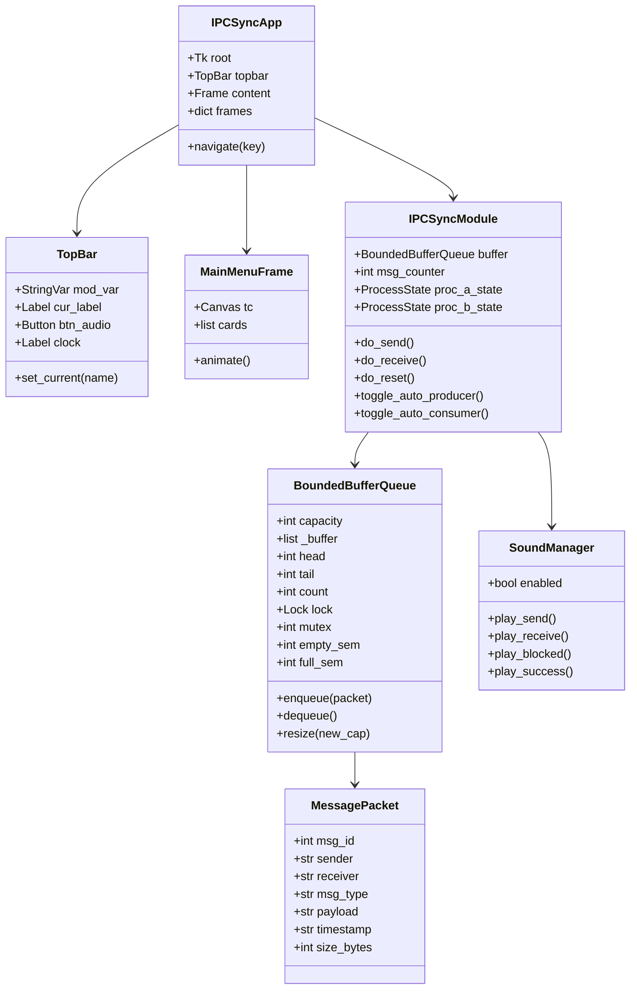

# TECHNICAL DOCUMENTATION: IPC & SYNCHRONIZATION ARCADE
**Course Module:** Operating Systems (OS) Simulation Suite  
**Topic:** Interprocess Communication (IPC) and Process Synchronization  
**Theme:** Pac-Man 1980s Retro Arcade Edition  
**Language & Framework:** Python 3 + Tkinter (Zero external library dependencies)  
**Deliverable Status:** Complete, Integrated, and Verified  

---

## 1. Executive Summary & System Overview

The **IPC & Synchronization Arcade** is an instructional, interactive simulation software that demonstrates how operating system processes exchange information and coordinate execution. Built with a retro Pac-Man arcade aesthetic, the simulator translates abstract theoretical concepts—message passing, bounded buffers, mutual exclusion, counting semaphores, race conditions, backpressure, and starvation—into intuitive, visual, and gamified mechanics.

The application satisfies all integration requirements:
- **Integrated Execution:** Runs as a single unified desktop application hosting all six operating system simulation modules.
- **Assigned Deep-Dive Module (Module 1):** Full-featured IPC & Synchronization simulation with manual, automated, challenge, and quiz modes.
- **Companion Interactive Modules (Modules 2–6):** Functional interactive simulations for CPU Scheduling, Memory Management, Deadlock/Dining Philosophers, File Systems/Inodes, and Process Management.
- **Consistent GUI Design Language:** High-contrast retro arcade theme with glowing neon palettes (`#FFD700`, `#00E5FF`, `#FF4081`, `#00E676`), Courier New and Consolas typography, fluid animations, and non-blocking 8-bit synthetic sound effects.

---

## 2. Theoretical Background & System Logic

### 2.1 The Interprocess Communication (IPC) Problem
Modern operating systems enforce **hardware-assisted memory protection** (virtual address space isolation). Consequently, process $P_1$ cannot directly read or write the address space of process $P_2$. 

Cooperating processes communicate via two primary paradigms:
1. **Shared Memory:** High throughput, but requires user-level synchronization.
2. **Message Passing:** Kernel-managed communication using `send()` and `receive()` primitives. Message passing decouples process lifetimes, simplifies synchronization, and works seamlessly across multi-core and distributed architectures.

The simulation models both:
- **Indirect (Mailbox / Port) Communication:** Messages are sent to and retrieved from a shared bounded mailbox. Processes communicate without explicit peer IDs.
- **Direct Communication:** Sender explicitly addresses the recipient process (e.g., `send(Blinky, message)`).

---

### 2.2 The Bounded-Buffer (Producer-Consumer) Problem
In a bounded buffer of capacity $N$:
- **Producer (Pac-Man, PID: 101):** Generates message packets (Power Pellets, Bonus Cherries, Control Pulses) and appends them to the queue.
- **Consumer (Ghost - Blinky/Pinky/Inky/Clyde, PID: 202):** Dequeues message packets and processes them.

#### The Three Core Constraints:
1. **Mutual Exclusion:** At most one process may alter queue pointers (`head`, `tail`, `count`) at any instant to prevent race conditions.
2. **Buffer Full (Backpressure / Overflow):** If the buffer contains $N$ items, any producer attempt to write must suspend the producer in a `BLOCKED` state until the consumer dequeues an item.
3. **Buffer Empty (Starvation / Underflow):** If the buffer contains $0$ items, any consumer attempt to read must suspend the consumer in a `BLOCKED` state until the producer enqueues an item.

---

### 2.3 Dijkstra's Three-Semaphore Algorithm & Invariants

To achieve race-free synchronization, the simulator implements Dijkstra's classical bounded-buffer semaphore algorithm utilizing three distinct semaphores:

| Semaphore | Type | Initial Value | Purpose |
| :--- | :--- | :--- | :--- |
| `mutex` | Binary Semaphore | `1` | Enforces Mutual Exclusion inside the Critical Section |
| `empty` | Counting Semaphore | $N$ (Buffer Capacity) | Tracks available empty slots; blocks producer when `0` |
| `full` | Counting Semaphore | `0` | Tracks occupied slots; blocks consumer when `0` |

#### Producer Algorithm (`do_send`):
```text
algorithm Producer_Send(packet):
    wait(empty)       // Decrements empty slots; if empty == 0, BLOCKS producer
    wait(mutex)       // Acquires mutual exclusion lock (mutex becomes 0)
    
    // --- CRITICAL SECTION BEGIN ---
    buffer[tail] ← packet
    tail ← (tail + 1) mod Capacity
    count ← count + 1
    // --- CRITICAL SECTION END ---
    
    signal(mutex)     // Releases mutual exclusion lock (mutex becomes 1)
    signal(full)      // Increments full slots; wakes any sleeping consumer
```

#### Consumer Algorithm (`do_receive`):
```text
algorithm Consumer_Receive():
    wait(full)        // Decrements full slots; if full == 0, BLOCKS consumer
    wait(mutex)       // Acquires mutual exclusion lock (mutex becomes 0)
    
    // --- CRITICAL SECTION BEGIN ---
    packet ← buffer[head]
    buffer[head] ← null
    head ← (head + 1) mod Capacity
    count ← count - 1
    // --- CRITICAL SECTION END ---
    
    signal(mutex)     // Releases mutual exclusion lock (mutex becomes 1)
    signal(empty)     // Increments empty slots; wakes any sleeping producer
    return packet
```

#### Fundamental Mathematical Invariant:
At all times outside the critical section, the following relationship holds strictly:
$$\text{empty\_sem} + \text{full\_sem} = N \quad (\text{where } N = \text{Capacity})$$
$$\text{count} = \text{full\_sem} = N - \text{empty\_sem}$$

This invariant is verified by the automated unit test suite on every operation.

---

## 3. Software Architecture & Implementation Details

### 3.1 Class Architecture & Module Hierarchy



---

### 3.2 Data Structures

#### 1. `MessagePacket`
Encapsulates an OS packet header and payload:
- `msg_id` (`int`): Unique monotonic transaction identifier.
- `sender` (`str`): Sender process moniker and PID (`Pac-Man [PID: 101]`).
- `receiver` (`str`): Target ghost entity (`Blinky [PID: 202]`, `Pinky`, etc.).
- `msg_type` (`str`): IPC packet category (`Power Pellet`, `Radar Pulse`, `Bonus Fruit`).
- `payload` (`str`): Text body content.
- `icon` (`str`): Retro icon glyph (`🟡`, `🍒`, `🍓`, `⚡`, `📡`, `🔑`).
- `timestamp` (`str`): Kernel dispatch timestamp (`HH:MM:SS`).
- `size_bytes` (`int`): Serialized packet footprint in bytes.

#### 2. `BoundedBufferQueue`
Implements a circular ring buffer with thread-safe semaphore accounting:
- Backed by a fixed-length Python list `[None] * capacity`.
- Index arithmetic: `tail = (tail + 1) % capacity` and `head = (head + 1) % capacity`.
- Dynamic resizing: Supports real-time resizing (1–10 slots) while safely preserving FIFO ordering and re-establishing semaphore balances.

---

### 3.3 Module 1 Sub-Tab Breakdown

| Sub-Tab | Title | Capabilities |
| :--- | :--- | :--- |
| **Tab 1** | **🕹️ Simulation Arena** | Interactive canvas featuring animated Pac-Man producer, Ghost consumer, traveling message packets, circular mailbox slots, live 3-semaphore meters, pseudocode execution tracer, packet inspector, and terminal kernel log. Includes manual dispatch and automated producer-consumer rate generators. |
| **Tab 2** | **🏆 Challenge Missions** | Gamified laboratory featuring 4 progressive OS missions: <br>1. *The First Handshake* (Basic Send)<br>2. *The Bounded Overflow Test* (Trigger Buffer Full Block)<br>3. *Ghost Starvation Rescue* (Trigger Buffer Empty Block and Rescue)<br>4. *Dynamic Rate Balancing* (Maintain 30%–70% buffer occupancy for 5 seconds). Real-time score counter and rank progression. |
| **Tab 3** | **🧠 Arcade Quiz Battle** | Interactive 5-question multiple choice OS challenge with real-time feedback, detailed instructional explanations, and animated Pac-Man progress tracker across dots towards a bonus cherry fruit. |
| **Tab 4** | **📖 OS Concept Guide** | Comprehensive textbook-grade reference manual covering IPC theory, shared memory vs. message passing, Dijkstra's algorithm, synchronization proofs, and real-world OS equivalents (UNIX pipes, POSIX queues, Windows ALPC). |

---

### 3.4 Companion Modules (Modules 2 to 6)

1. **Module 2: CPU Scheduling Arcade (`CPUSchedulingModule`)**
   - Implements **Round Robin (RR)**, **FCFS**, and **Shortest Job First (SJF)**.
   - Pac-Man CPU core visually executes and eats burst cycles along an animated Gantt chart timeline.
   - Live ready queue status, burst tracking, and turnaround metrics.

2. **Module 3: Memory Management Arcade (`MemoryManagementModule`)**
   - Implements **Physical Memory Paging** and **First-Fit Contiguous Allocation**.
   - 16-frame memory matrix (4×4 grid) where processes request and release frame blocks.
   - Demonstrates out-of-memory errors and frame fragmentation.

3. **Module 4: Deadlock & Synchronization Arcade (`DeadlockModule`)**
   - Implements Dijkstra's **Dining Philosophers Problem**.
   - 4 Ghosts competing for 4 shared power chopsticks (mutexes).
   - Demonstrates Coffman's 4 conditions: Mutual Exclusion, Hold & Wait, No Preemption, Circular Wait.
   - Includes one-click Deadlock Trigger vs. Resource Hierarchy Prevention.

4. **Module 5: File Systems Arcade (`FileSystemsModule`)**
   - Implements **Inode-based Index Allocation** on a circular 12-sector disk.
   - Demonstrates file creation, sector mapping, fragmentation, and directory tables.

5. **Module 6: Process Management Arcade (`ProcessManagementModule`)**
   - Implements the canonical **5-State Process Lifecycle** (`NEW` $\rightarrow$ `READY` $\rightarrow$ `RUNNING` $\rightarrow$ `WAITING` $\rightarrow$ `TERMINATED`).
   - Includes real-time **Process Control Block (PCB)** inspector displaying PID, State, Program Counter (PC), CPU Registers, and Memory limits.

---

### 3.5 Non-Blocking Audio Architecture
The audio engine (`SoundManager`) uses the Windows `winsound.Beep` API executed inside asynchronous daemon worker threads:
- Non-blocking: Audio playback never halts or hitches GUI rendering or animation timers.
- Fail-safe: Wrapped in `try-except` blocks; gracefully no-ops if sound hardware is busy or on non-Windows platforms.
- User togglable: Audio can be muted or unmuted dynamically with the top bar toggle.

---

## 4. Verification & Validation Summary

The software was verified through rigorous unit testing and automated integration tests:
- **Test File:** `test_ipc_simulator.py`
- **Total Test Cases:** 10 comprehensive tests
- **Result:** 100% Passed (0 Failures, 0 Errors)
- **Key Assertions Verified:**
  - FIFO ordering preservation across multiple enqueues and dequeues.
  - Proper blocking of producer upon reaching buffer limit ($N$).
  - Proper blocking of consumer upon attempting dequeue from empty buffer ($0$).
  - Preservation of Dijkstra semaphore invariants ($\text{empty} + \text{full} = N$).
  - GUI state machine responsiveness and seamless navigation across all 6 modules.
